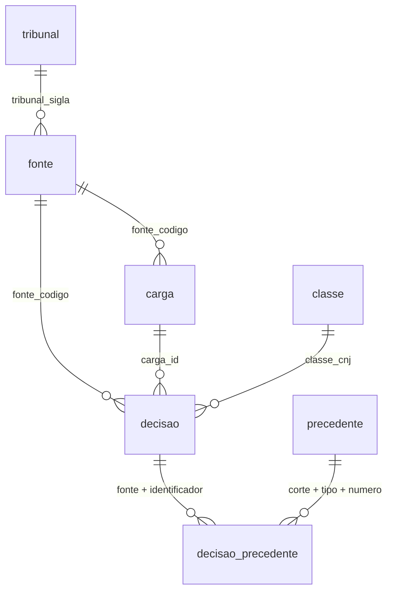

# Data dictionary — Case Law

Every table and column in the `core` schema, which is the contract the API reads
and the only layer that is published to the servers.

For how the data gets here, see [`etl.md`](etl.md).

**Conventions used below**

- *Fill* is the share of rows where the column is not NULL, measured on
  2026-10-23 against the development database. It is more useful than the
  nullability flag: every column is technically nullable because SQLMesh builds
  with `CREATE TABLE AS`, so the constraint lives in the audits, not the DDL.
- *Collected* means it arrived in the source response. *Derived* means a rule
  read it out of free text — those carry a coverage figure and a failure mode.
- Column and value names are in Portuguese because the domain is Brazilian
  jurisprudence and the terms are legal terms of art. Translating `ementa` or
  `provido` would lose their meaning.

**Collection at a glance**

| | |
|---|---|
| Decisions | 991,163 |
| Period covered | 1989-02-19 → 2026-09-17 |
| Sources | STJ 876,996 · TJDFT 114,167 |
| Citation links | 375,189 |
| Precedents | 1,482 |

---

## The dimensional model

`core` is a **flattened star schema**. `core.decisao` is the fact table; four
dimensions surround it, and a bridge carries the many-to-many to precedents.

| Role | Table | Grain |
|---|---|---|
| **Fact** | `core.decisao` | one judicial decision |
| Dimension | `core.tribunal` | one court |
| Dimension | `core.fonte` | one connector |
| Dimension | `core.classe_processual` | one CNJ procedural class |
| Dimension | `core.carga` | one extraction run — the lineage dimension, which answers *how old is this* |
| **Bridge** | `core.decisao_precedente` | one citation of one precedent by one decision |
| Dimension | `core.precedente` | one súmula or tema |

Two modelling decisions are deliberate and worth stating, because both trade a
normal-form virtue for something the product needs more:

**Natural keys, not surrogate keys.** The fact is keyed by
`(fonte_codigo, identificador_fonte)` rather than by a generated integer. The
hot query is a paginated full-text search, and every join is work on the
critical path; a surrogate key would add one lookup to each dimension without
making any query answerable that is not answerable now.

**Low-cardinality attributes stay on the fact.** `orgao_julgador` (32 distinct
values) and `relator` (237) are denormalised rather than pulled into dimensions
of their own. They are 1.6 % of the base against 3 GB of text and index:
normalising them would save roughly 40 MB and cost a join on every search.

The bridge is what makes adherence measurable. A decision cites several
precedents and Súmula 7/STJ is cited by 119,035 decisions, so neither side can
hold a foreign key to the other.

---

## core.decisao

One row per judicial decision. **991,163 rows.** The central table; everything
else either describes it or hangs off it.

**Grain:** `(fonte_codigo, identificador_fonte)` — unique, audited.

| Column | Type | Fill | Origin | Description |
|---|---|---|---|---|
| `fonte_codigo` | text | 100 % | collected | Which connector loaded it. FK → `core.fonte.codigo`. Domain: `stj-espelhos`, `tjdft-jurisdf` |
| `identificador_fonte` | varchar | 100 % | collected | The source's own record id. Half of the grain |
| `identificador_documento` | varchar | 100 % | collected | The token the court's site opens the document by. **Not the same as above**: the TJDFT opens by a uuid, the STJ by its registry number. Audited separately for exactly this reason |
| `tribunal_sigla` | text | 100 % | seed join | FK → `core.tribunal.sigla`. `STJ` or `TJDFT` |
| `processo` | varchar | 100 % | collected | Case number. **STJ values are not CNJ-format** — 0 % match it, so STJ decisions cannot be tied to a case |
| `orgao_julgador` | varchar | 100 % | collected | The panel or chamber that judged |
| `relator` | text | 100 % | collected | Reporting judge |
| `classe_cnj` | bigint | 99.6 % | derived | CNJ procedural class. FK → `core.classe_processual.codigo_cnj`. Resolved by joining the class name the STJ writes out in full |
| `data_julgamento` | date | 100 % | collected | When it was judged |
| `data_publicacao` | date | 98.6 % | collected | When it was published |
| `data_referencia` | date | 100 % | derived | `COALESCE` of the two above. The column every filter and sort uses, so that a decision missing one date is still reachable |
| `ementa` | varchar | 100 % | collected | The headnote — the summary the court itself writes. The main search target |
| `tipo_texto` | text | 100 % | derived | What kind of text `ementa` holds. Only value today: `ementa_completa` |
| `decisao_texto` | text | 99.9 % | collected | The dispositive — the operative part. What `resultado` and `deliberacao` are read from |
| `conhecimento` | text | **0 %** | — | Whether the appeal was admitted. **Not implemented**; the column exists and is NULL everywhere |
| `resultado` | text | 95.9 % | derived | Outcome. Domain: `provido`, `parcialmente_provido`, `negado` |
| `deliberacao` | text | 99.8 % | derived | How the panel decided. Domain: `unanime`, `maioria` |
| `turma_recursal` | boolean | 2.1 % true | collected | Whether it came from a small-claims appellate panel |
| `possui_inteiro_teor` | boolean | 11.5 % true | collected | Whether the full text exists at the source |
| `url_fonte` | text | 100 % | derived | Link to the official document. Built by substituting `identificador_documento` into the source's template — the APIs do not return a link. Audited to actually contain the identifier |
| `link_valido` | boolean | **0 %** | verified | Three states: `TRUE` reachable, `FALSE` gone, `NULL` not checked. NULL is not FALSE. Not yet run against the current collection |
| `carga_id` | varchar | — | lineage | Which extraction run brought it. FK → `core.carga.carga_id` |
| `carregado_em` | timestamptz | 100 % | lineage | When the transformation last built this row |
| `ementa_busca` | tsvector | 100 % | derived | Full-text index over `ementa`, using the `portugues_sem_acento` configuration so that accents do not change results |

### Derived-column failure modes

| Column | What breaks it | Guard |
|---|---|---|
| `resultado` | cascade order — `NEGAR PROVIMENTO` contains `PROVIMENTO` | `resultado_sem_contradicao` + 25 Python tests |
| `deliberacao` | court rewords the dispositive | `deliberacao_com_cobertura` ≥ 95 % |
| `classe_cnj` | the STJ changes how it spells a class name | `classe_com_cobertura` ≥ 95 % |
| `url_fonte` | template loses its `{identificador}` placeholder | `url_carrega_o_identificador` |

---

## core.decisao_precedente

Which precedent each decision cited. **375,189 rows** over 275,659 distinct
decisions — many-to-many, because one decision cites several precedents and
Súmula 7/STJ alone appears in 119,035 of them.

**Grain:** `(fonte_codigo, identificador_fonte, corte, tipo, numero)`.

| Column | Type | Fill | Description |
|---|---|---|---|
| `fonte_codigo` | text | 100 % | FK → `core.decisao` (half of its grain) |
| `identificador_fonte` | varchar | 100 % | FK → `core.decisao` (the other half) |
| `corte` | text | 100 % | Which court settled it. Domain: `STJ`, `STF`. Required: Súmula 7/STJ and Súmula 7/STF are different precedents |
| `tipo` | text | 100 % | Domain: `sumula` (330,090), `tema` (45,099) |
| `numero` | bigint | 100 % | The precedent's number |
| `trecho` | text | 100 % | 220 characters of the ementa around the citation. **Cut by position, not captured by the same expression** — capturing context made one citation swallow the next, which cost 5.07 % of the links |
| `resolvida` | boolean | 96.0 % true | Whether the citation matched a row in `core.precedente` — 96.7 % for súmulas, 90.9 % for temas. The 4 % that did not are **kept on purpose**: discarding them would hide how big the gap is, and the gap is the measure that says whether widening collection is worth it |
| `aderencia` | text | 75.8 %¹ | How the court used it. Domain: `seguiu`, `afastou`, `distinguiu` |
| `carregado_em` | timestamptz | 100 % | When the transformation built this row |

¹ *Pending: the figure is the verified result of the rule; the column reads NULL
in the database until the next `sqlmesh plan` rebuilds the table.*

### Reading `aderencia` honestly

| Value | Share | Reliability |
|---|---|---|
| `seguiu` | 68.9 % | High — the positive vocabulary near a citation is unambiguous |
| `afastou` | 6.3 % | **Lower** — the negation sometimes belongs to a nearby article rather than to the súmula |
| `distinguiu` | 0.6 % | Rare but explicit |
| NULL | 24.2 % | Decisions citing several precedents where the snippet carries no verb. Attributing one would be a guess |

**Scope warning.** 75.3 % of súmula citations are admissibility barriers —
Súmula 7/STJ ("no re-examination of evidence") is 36 % by itself. An adherence
indicator computed over all citations therefore describes admissibility more
than it describes adherence on the merits. Excluding STJ 5, 7, 83, 182, 211,
284, 315 and STF 279–284 leaves roughly 82,000 links.

---

## core.precedente

What the higher courts settled, and that decisions cite. **1,482 rows.**

**Grain:** `(corte, tipo, numero)`.

| Column | Type | Fill | Description |
|---|---|---|---|
| `corte` | text | 100 % | `STJ` or `STF` |
| `tipo` | text | 100 % | `sumula` or `tema` |
| `numero` | bigint | 100 % | The precedent's number |
| `enunciado` | text | 100 % | The text of the holding. Audited to be at least 40 characters, so a capture that caught punctuation instead of text fails the build |
| `situacao` | text | 77.1 % | Status (in force, cancelled…). **NULL for every reconstructed súmula on purpose** — showing a cancelled súmula as being in force is a serious error in a legal tool, so the screen says it does not know |
| `data` | date | 76.8 % | Judgment date. Catalogue temas only |
| `url_fonte` | text | **0 %** | No public catalogue exists to link to. A documented deviation from the acceptance criterion |
| `origem` | text | 100 % | How this row came to exist. `catalogo` (1,142 temas, from the STJ open data portal) or `reconstruido` (340 súmulas, rebuilt from the collection) |
| `transcricoes` | bigint | 22.9 % | How many decisions quoted this exact sentence. Only reconstructed rows have it — it is the evidence for the text. Súmula 7/STJ: 1,843 |
| `carregado_em` | timestamptz | 100 % | When the transformation built this row |

**Why súmulas are reconstructed.** No public catalogue exists anywhere — the STJ
open data portal publishes none, the BDJur holds only internal manuals,
`scon.stj.jus.br` answers 403, and the STF and CNJ portals do not resolve. The
text is rebuilt from decisions that quote it between quotation marks, and
**repetition is the verification**: a floor of three identical transcriptions
discards a capture that caught neighbouring text. The 340 reconstructed súmulas
cover 96.7 % of all súmula citations.

---

## core.carga

One row per extraction run — the lineage anchor. **145 rows**, all
`tjdft-jurisdf`, 2026-09-16 to 2026-09-18.

| Column | Type | Description |
|---|---|---|
| `carga_id` | varchar | dlt's own run id. Read from `raw._dlt_loads` |
| `fonte_codigo` | text | FK → `core.fonte.codigo` |
| `concluida_em` | timestamptz | When the run finished |
| `status` | text | Domain today: `concluida` |
| `registros_lidos` | bigint | Read from the source |
| `registros_gravados` | bigint | Written to raw |
| `descartados_sigilo` | bigint | Dropped for being under seal. Totals 12,659 |
| `links_invalidos` | bigint | Links the verification found broken |
| `links_nao_verificados` | bigint | Links nobody has checked. **Reported beside the above on purpose** — zero invalid means little when nobody looked |

> **Two caveats.** The STJ bulk load is not represented here, so the table
> accounts for 107,828 records against 991,163 decisions in `core.decisao`. And
> because the TJDFT connector writes with `merge`, `registros_gravados` summed
> across runs is not a collection total — a re-run rewrites rather than adds.

---

## core.fonte

One row per connector. **3 rows.** Seeded from
[`seeds/fonte.csv`](../../pipeline/transformations/seeds/fonte.csv).

| Column | Type | Description |
|---|---|---|
| `codigo` | text | PK. The literal that ties connector, seed and model together |
| `nome` | text | Human-readable name |
| `conteudo` | text | What this source carries. Domain: `decisao`, `precedente`. Exists so that a test asking for a document URL pattern only asks it of sources that have documents |
| `tribunal_sigla` | text | FK → `core.tribunal.sigla` |
| `url_base` | text | The portal's root |
| `url_documento_template` | text | Pattern with a single `{identificador}` placeholder. **This is what makes a link to the official document possible** — no court API returns one |
| `status` | text | Domain: `ativa` |
| `cobertura_inicio` | double precision | First year covered |
| `cobertura_fim` | double precision | Last year covered |
| `observacoes` | text | Free notes |

Current rows: `tjdft-jurisdf`, `stj-espelhos`, `stj-precedentes`.

---

## core.classe_processual

The CNJ procedural class table. **847 rows.** Seeded from
[`seeds/classe_processual.csv`](../../pipeline/transformations/seeds/classe_processual.csv),
loaded from the CNJ SGT web service.

| Column | Type | Description |
|---|---|---|
| `codigo_cnj` | bigint | PK. The national code |
| `codigo_pai` | double precision | Parent class, for the hierarchy. NULL at a root |
| `nome` | text | Class name. **Not unique** — 83 names are shared by more than one code, which is why the table must be indexed by code, never by name |

Resolution walks the tree with a recursive CTE, matching on the whole name first
and then on the name with any `NOS/NAS/NO/NA/EM …` suffix stripped. This lifted
class coverage from 11.5 % to 99.6 %.

> The CNJ's public SGT database contains stored PHP injection payloads under
> codes 100 and 1198. They are filtered explicitly during the load.

---

## core.tribunal

**2 rows.** Seeded from
[`seeds/tribunal.csv`](../../pipeline/transformations/seeds/tribunal.csv).

| Column | Type | Description |
|---|---|---|
| `sigla` | text | PK. `STJ`, `TJDFT` |
| `nome` | text | Full name |
| `esfera` | text | Domain: `superior` (STJ), `distrital` (TJDFT) |
| `uf` | text | State |

---

## Schemas outside `core`

Not published to the servers, but part of how the system works.

| Schema | Holds |
|---|---|
| `raw` | the sources' own responses, field names unchanged. 2.4 M rows across 6 tables. Includes documents under seal, which is one reason it never leaves the machine that collected it |
| `raw_staging` | dlt's landing area during a load |
| `sqlmesh__core` | the physical, fingerprinted tables the `core` views read. 83 indexes |
| `sqlmesh` | SQLMesh's own state: model versions, environments, plan history |
| `verificacao` | `link(fonte_codigo, identificador, valido, verificado_em)` — the link check's output, kept outside `core` so that rebuilding `core` does not erase it |
| `meta` | on the **published servers only**: `publicacao`, one row per publication with timestamp, decision count and sending machine. Lives outside `core` because the atomic swap would otherwise drop it. This is where the "last updated" on screen comes from |

---

## Relationships

`decisao_precedente → precedente` is a **soft** reference: 4 % of links point at
a precedent not in the catalogue, and `resolvida` records that rather than the
row being dropped.
