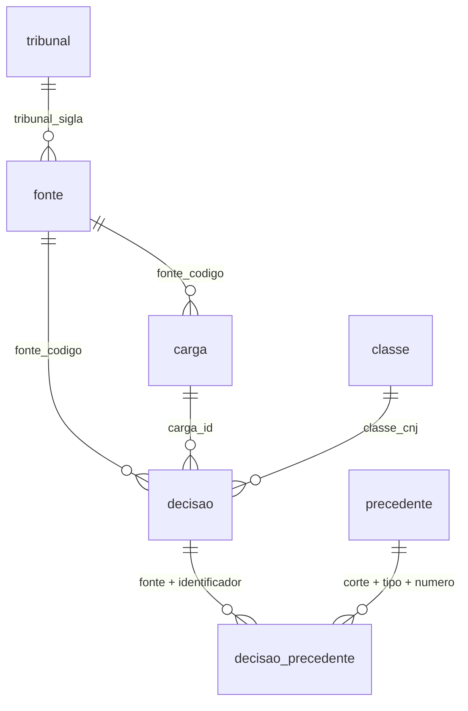

# Data dictionary — Case Law

Every table and column in the `core` schema, which is the contract the API reads
and the only layer that is published to the servers.

For how the data gets here, see [`etl.md`](etl.md).

**Conventions used below**

- *Fill* is the share of rows where the column is not NULL, measured on
  2026-11-18 against the development database. It is more useful than the
  nullability flag: every column is technically nullable because SQLMesh builds
  with `CREATE TABLE AS`, so the constraint lives in the audits, not the DDL.
- *Collected* means it arrived in the source response. *Derived* means a rule
  read it out of free text — those carry a coverage figure and a failure mode.
- Column and value names are in Portuguese because the domain is Brazilian
  jurisprudence and the terms are legal terms of art. Translating `ementa` or
  `provido` would lose their meaning.

**Collection at a glance**

| | |
|---|---|
| Decisions | 1,360,708 |
| Period covered | 1892-04-27 → 2026-11-16 |
| Sources | STJ 876,996 · STF 369,545 · TJDFT 114,167 |
| Citation links | 459,800 |
| Precedents | 1,525 |

The period starts in 1892 because the STF's own collection does. Half of what
that court publishes — 189,435 acordaos — predates the STJ's creation in 1989,
so the collection's floor is no longer a single court's.

---

## The dimensional model

`core` is a **flattened star schema**. `core.decisao` is the fact table; four
dimensions surround it, and a bridge carries the many-to-many to precedents.

| Role | Table | Grain |
|---|---|---|
| **Fact** | `core.decisao` | one judicial decision |
| Dimension | `core.tribunal` | one court |
| Dimension | `core.fonte` | one connector |
| Dimension | `core.classe_processual` | one CNJ procedural class |
| Dimension | `core.carga` | one extraction run — the lineage dimension, which answers *how old is this* |
| **Bridge** | `core.decisao_precedente` | one citation of one precedent by one decision |
| Dimension | `core.precedente` | one súmula or tema |

Two modelling decisions are deliberate and worth stating, because both trade a
normal-form virtue for something the product needs more:

**Natural keys, not surrogate keys.** The fact is keyed by
`(fonte_codigo, identificador_fonte)` rather than by a generated integer. The
hot query is a paginated full-text search, and every join is work on the
critical path; a surrogate key would add one lookup to each dimension without
making any query answerable that is not answerable now.

**Low-cardinality attributes stay on the fact.** `orgao_julgador` (36 distinct
values) and `relator` (479) are denormalised rather than pulled into dimensions
of their own. Three courts and 1.36 M decisions did not change the shape of the
argument: the STF judges in four bodies and the whole collection still names
fewer than five hundred reporting judges, against 5 GB of text and index.
Normalising them would save tens of megabytes and cost a join on every search.

The bridge is what makes adherence measurable. A decision cites several
precedents and Súmula 7/STJ is cited by 128,237 decisions, so neither side can
hold a foreign key to the other.

---

## core.decisao

One row per judicial decision. **1,360,708 rows.** The central table;
everything else either describes it or hangs off it.

**Grain:** `(fonte_codigo, identificador_fonte)` — unique, audited.

| Column | Type | Fill | Origin | Description |
|---|---|---|---|---|
| `fonte_codigo` | text | 100 % | collected | Which connector loaded it. FK → `core.fonte.codigo`. Domain: `stj-espelhos`, `stf-jurisprudencia`, `tjdft-jurisdf` |
| `identificador_fonte` | varchar | 100 % | collected | The source's own record id. Half of the grain |
| `identificador_documento` | varchar | 100 % | collected | The token the court's site opens the document by. **Not the same as above**: the TJDFT opens by a uuid, the STJ by its registry number, and the STF by a whole query string whose own parameter name changes with the era. Audited separately for exactly this reason |
| `tribunal_sigla` | text | 100 % | seed join | FK → `core.tribunal.sigla`. `STJ`, `STF` or `TJDFT` |
| `processo` | varchar | 100 % | collected | Case number. **Neither the STJ's nor the STF's values are CNJ-format** — 0 % match it on either side (the STF writes `AI 6093`, `RvC 4081`), so only TJDFT decisions can be tied to a case |
| `orgao_julgador` | varchar | 98.4 % | collected | The panel or chamber that judged. 94.0 % on the STF side, where the older acordaos name none |
| `relator` | text | 100 % | collected | Reporting judge |
| `classe_cnj` | bigint | 99.4 % | derived | CNJ procedural class. FK → `core.classe_processual.codigo_cnj`. Resolved by joining the class name the court writes out. 99.0 % on the STF side, which abbreviates it instead (`EMB.DECL.NO AG.REG.NO RE`) and needs the abbreviations expanded first |
| `data_julgamento` | date | 100 % | collected | When it was judged |
| `data_publicacao` | date | 97.4 % | collected | When it was published |
| `data_referencia` | date | 100 % | derived | `COALESCE` of the two above. The column every filter and sort uses, so that a decision missing one date is still reachable |
| `ementa` | varchar | 100 % | collected | The headnote — the summary the court itself writes. The main search target |
| `tipo_texto` | text | 100 % | derived | What kind of text `ementa` holds. Only value today: `ementa_completa` |
| `decisao_texto` | text | 96.8 % | collected | The dispositive — the operative part. What `resultado` and `deliberacao` are read from. 88.2 % on the STF side, which publishes the session minutes rather than a dispositive field |
| `conhecimento` | text | **0 %** | — | Whether the appeal was admitted. **Not implemented**; the column exists and is NULL everywhere |
| `resultado` | text | 91.2 % | derived | Outcome. Domain: `provido`, `parcialmente_provido`, `negado`. 78.6 % on the STF side, for the same reason as `decisao_texto` |
| `deliberacao` | text | 94.9 % | derived | How the panel decided. Domain: `unanime`, `maioria`. 81.8 % on the STF side |
| `turma_recursal` | boolean | 1.6 % true | collected | Whether it came from a small-claims appellate panel. Only the TJDFT has them; `FALSE` for both superior courts |
| `possui_inteiro_teor` | boolean | 35.5 % true | collected | Whether the full text exists at the source. The jump is the STF, where it is **100 %** — every acordao it publishes carries an address for its own full text, which the STJ's mirrors never do |
| `url_fonte` | text | 100 % | derived | Link to the official document. Built by substituting `identificador_documento` into the source's template — the APIs do not return a link. Audited to actually contain the identifier |
| `link_valido` | boolean | **0 %** | verified | Three states: `TRUE` reachable, `FALSE` gone, `NULL` not checked. NULL is not FALSE. The check writes to `verificacao.link` and this column is filled from it **at build time**, so a verdict reaches the screen only at the next rebuild: 400 STF records are verified and valid there today, and still read NULL here |
| `carga_id` | varchar | — | lineage | Which extraction run brought it. FK → `core.carga.carga_id` |
| `carregado_em` | timestamptz | 100 % | lineage | When the transformation last built this row |
| `ementa_busca` | tsvector | 100 % | derived | Full-text index over `ementa`, using the `portugues_sem_acento` configuration so that accents do not change results |

### Derived-column failure modes

| Column | What breaks it | Guard |
|---|---|---|
| `resultado` | cascade order — `NEGAR PROVIMENTO` contains `PROVIMENTO` | `resultado_sem_contradicao` + 25 Python tests |
| `deliberacao` | court rewords the dispositive | `deliberacao_de_valor_conhecido` |
| `classe_cnj` | a court changes how it writes a class name | `classe_de_codigo_conhecido` |
| `url_fonte` | template loses its `{documento}` placeholder | `url_carrega_o_identificador` |

**These guards check domains, not coverage.** They catch a value that is not in
the list and a link that lost its token; none of them has a floor on how full
the column is. Earlier versions of this table claimed a `deliberacao_com_cobertura`
and a `classe_com_cobertura` at 95 % — neither audit exists, and saying so
mattered: the STF arrived with `resultado` at 78.6 %, which a 95 % floor would
have stopped and nothing did. What the drop means is in `core.decisao` above,
beside each column.

---

## core.decisao_precedente

Which precedent each decision cited. **459,800 rows** over 340,710 distinct
decisions — many-to-many, because one decision cites several precedents and
Súmula 7/STJ alone appears in 128,237 of them.

**Grain:** `(fonte_codigo, identificador_fonte, corte, tipo, numero)`.

| Column | Type | Fill | Description |
|---|---|---|---|
| `fonte_codigo` | text | 100 % | FK → `core.decisao` (half of its grain) |
| `identificador_fonte` | varchar | 100 % | FK → `core.decisao` (the other half) |
| `corte` | text | 100 % | Which court settled it. Domain: `STJ` (323,305), `STF` (136,495). Required: Súmula 7/STJ and Súmula 7/STF are different precedents |
| `tipo` | text | 100 % | Domain: `sumula` (391,126), `tema` (68,674) |
| `numero` | bigint | 100 % | The precedent's number |
| `trecho` | text | 100 % | 220 characters of the ementa around the citation. **Cut by position, not captured by the same expression** — capturing context made one citation swallow the next, which cost 5.07 % of the links |
| `resolvida` | boolean | 84.7 % true | Whether the citation matched a row in `core.precedente` — **97.3 % for súmulas, 12.9 % for temas**. The gap is almost entirely the STF's: `core.precedente` holds temas from the STJ's open data portal, and the STF's repercussão geral temas have no catalogue there to match. Unresolved links are **kept on purpose**: discarding them would hide how big the gap is, and the gap is the measure that says whether widening collection is worth it |
| `aderencia` | text | 75.8 %¹ | How the court used it. Domain: `seguiu`, `afastou`, `distinguiu` |
| `carregado_em` | timestamptz | 100 % | When the transformation built this row |

¹ *Pending: the figure is the verified result of the rule; the column reads NULL
in the database until the next `sqlmesh plan` rebuilds the table.*

### Reading `aderencia` honestly

| Value | Share | Reliability |
|---|---|---|
| `seguiu` | 65.4 % | High — the positive vocabulary near a citation is unambiguous |
| `indeterminado` | 24.7 % | Citations whose snippet carries no verb. The value is a value, not an absence: in a legal tool "I do not know" is an answer, and attributing one would be a guess |
| `afastou` | 6.4 % | **Lower** — the negation sometimes belongs to a nearby article rather than to the súmula |
| `mencionou` | 3.0 % | Named without being applied |
| `distinguiu` | 0.6 % | Rare but explicit |

**Scope warning.** Most súmula citations are admissibility barriers —
Súmula 7/STJ ("no re-examination of evidence") is 128,237 links, 32.8 % of every
súmula citation in the collection, and Súmula 284/STF another 31,170. An
adherence indicator computed over all citations therefore describes
admissibility more than it describes adherence on the merits. Excluding STJ 5,
7, 83, 182, 211, 284, 315 and STF 279–284 leaves roughly 100,000 links.

---

## core.precedente

What the higher courts settled, and that decisions cite. **1,525 rows.**

**Grain:** `(corte, tipo, numero)`.

| Column | Type | Fill | Description |
|---|---|---|---|
| `corte` | text | 100 % | `STJ` or `STF` |
| `tipo` | text | 100 % | `sumula` or `tema` |
| `numero` | bigint | 100 % | The precedent's number |
| `enunciado` | text | 100 % | The text of the holding. Audited to be at least 40 characters, so a capture that caught punctuation instead of text fails the build |
| `situacao` | text | 74.9 % | Status (in force, cancelled…). **NULL for every reconstructed súmula on purpose** — showing a cancelled súmula as being in force is a serious error in a legal tool, so the screen says it does not know |
| `data` | date | 74.6 % | Judgment date. Catalogue temas only |
| `url_fonte` | text | **0 %** | No public catalogue exists to link to. A documented deviation from the acceptance criterion |
| `origem` | text | 100 % | How this row came to exist. `catalogo` (1,142 temas, from the STJ open data portal) or `reconstruido` (383 súmulas, rebuilt from the collection) |
| `transcricoes` | bigint | 25.1 % | How many decisions quoted this exact sentence. Only reconstructed rows have it — it is the evidence for the text. Súmula 7/STJ: 1,843 |
| `carregado_em` | timestamptz | 100 % | When the transformation built this row |

**Why súmulas are reconstructed.** No public catalogue exists anywhere — the STJ
open data portal publishes none, the BDJur holds only internal manuals,
`scon.stj.jus.br` answers 403, and the STF and CNJ portals do not resolve. The
text is rebuilt from decisions that quote it between quotation marks, and
**repetition is the verification**: a floor of three identical transcriptions
discards a capture that caught neighbouring text. The reconstructed súmulas
cover 97.3 % of all súmula citations.

The STF's arrival added 43 of them without any new rule. They are holdings that
only its own acordaos transcribe — the same mechanism reading a court that
quotes its own súmulas, which is the argument for reconstruction working rather
than fitting one source.

---

## core.carga

One row per extraction run — the lineage anchor. **26 rows**, 2026-10-10 to
2026-11-20, across six sources: 13 TJDFT runs, one each for the STJ's mirrors,
its qualified precedents, the BDJur, the STF and the CNJ's register. Eight
claim no source, which is a state the model keeps rather than guesses at — see
`fonte_codigo` below.

The source is attributed by which raw table received rows in the run, because
dlt does not record the extractor: every collection shares one `pipeline_name`
and one `_dlt_loads`. That means **one hand-written branch per source**, and a
source added without its branch does not fail — its runs fall into the
unclaimed group, and the RF16 screen then states "never collected" about a
source that delivered. `cnj-bnp` was added to the catalogue and to the
collection one commit before its branch, so `test_carga.py` now guards the
link.

| Column | Type | Description |
|---|---|---|
| `carga_id` | varchar | dlt's own run id. Read from `raw._dlt_loads` |
| `fonte_codigo` | text | FK → `core.fonte.codigo` |
| `concluida_em` | timestamptz | When the run finished |
| `status` | text | Domain today: `concluida` |
| `registros_lidos` | bigint | Read from the source |
| `registros_gravados` | bigint | Written to raw |
| `descartados_sigilo` | bigint | Dropped for being under seal. Totals 13,396 |
| `links_invalidos` | bigint | Links the verification found broken |
| `links_nao_verificados` | bigint | Links nobody has checked. **Reported beside the above on purpose** — zero invalid means little when nobody looked |

> **One caveat.** Because the connectors write with `merge`,
> `registros_gravados` summed across runs is not a collection total — a re-run
> rewrites rather than adds. The STF's single run reads 373,178 acordaos and
> 369,545 of them become decisions; the difference is documented in
> [`stf-source.md`](stf-source.md), not hidden in this table.

---

## core.fonte

One row per connector. **5 rows.** Seeded from
[`seeds/fonte.csv`](../../pipeline/transformations/seeds/fonte.csv).

| Column | Type | Description |
|---|---|---|
| `codigo` | text | PK. The literal that ties connector, seed and model together |
| `nome` | text | Human-readable name |
| `conteudo` | text | What this source carries. Domain: `decisao`, `precedente`, `doutrina`. Exists so that a test asking for a document URL pattern only asks it of sources that have documents |
| `tribunal_sigla` | text | FK → `core.tribunal.sigla` |
| `url_base` | text | The portal's root |
| `url_documento_template` | text | Pattern with a `{documento}` placeholder, and `{publicacao}` where the court needs a second value. **This is what makes a link to the official document possible** — no court API returns one |
| `status` | text | Domain: `ativa`, `bloqueada` |
| `observacoes` | text | Free notes |

Current rows: `tjdft-jurisdf`, `stj-espelhos`, `stj-precedentes`, `stj-bdjur`,
`stf-jurisprudencia`.

Adding the fifth one found a guard that could never have let it in.
`carga_de_fonte_conhecida` checked each run's source against this table, but a
model audit only resolves the models the audited model itself reads, and
`core.carga` does not read `core.fonte` — so the audit compared today's runs
against the **previously published** catalogue and failed every time a source
was new. It failed on the replan too, because promotion needs the plan to pass.
It is a standalone audit now, which makes both tables its own dependencies.

The period each source covers is **not** here. It was, as `cobertura_inicio`
and `cobertura_fim`, and SCRUM-156 recorded what that produced: the seed shipped
both columns empty, SQLMesh inferred `double precision` from a column with no
value, `infra/postgres/core.sql` declared `date`, and this table said "first
year covered" — four answers for one column, and no data in it. A period that
moves with every load cannot live in a hand-edited CSV, so it is derived now.
See `core.cobertura_fonte`.

---

## core.cobertura_fonte

What each source actually covers, measured over the published collection. **One
row per source in `core.fonte`**, including a source that has delivered nothing.

| Column | Type | Description |
|---|---|---|
| `fonte_codigo` | text | PK. FK → `core.fonte.codigo` |
| `conteudo` | text | Copied from `core.fonte`, so the period can be read against what kind of item it counts |
| `itens` | bigint | How many items of that content the source contributed. `0` for a source never collected |
| `itens_sem_data` | bigint | How many of them carry no date. Counted rather than hidden: a period computed over dated items says nothing about the undated ones |
| `cobertura_inicio` | date | The oldest item. `NULL` when the source has delivered nothing |
| `cobertura_fim` | date | The most recent item. `NULL` on the same condition |
| `precisao` | text | The granularity the source's own data supports. Domain: `dia`, `ano`, `nenhuma` |

`precisao` is what keeps an estimate from entering through the back door. The
BDJur publishes a year, not a date, so its period is stored as 1 January of that
year and marked `ano` — the interface writes "1953", never "1 de janeiro de
1953". RF16 forbids replacing an unknown date with an estimated value, and a day
nobody published is exactly that.

The rebuilt súmulas are left out of the precedent count: they come from
transcriptions in the collection rather than from a collection run, and none of
the 383 carries a date, so counting them would credit the STJ portal with a
period it never supplied.

The STF's row reports 44 items with no date against 369,545 collected. They are
acordaos from the first decades that carry neither a judgment nor a publication
date, and `itens_sem_data` is what keeps a period measured over dated items
from speaking for them.

---

## core.classe_processual

The CNJ procedural class table. **847 rows.** Seeded from
[`seeds/classe_processual.csv`](../../pipeline/transformations/seeds/classe_processual.csv),
loaded from the CNJ SGT web service.

| Column | Type | Description |
|---|---|---|
| `codigo_cnj` | bigint | PK. The national code |
| `codigo_pai` | double precision | Parent class, for the hierarchy. NULL at a root |
| `nome` | text | Class name. **Not unique** — 83 names are shared by more than one code, which is why the table must be indexed by code, never by name |

Resolution walks the tree with a recursive CTE, matching on the whole name first
and then on the name with any `NOS/NAS/NO/NA/EM …` suffix stripped. This lifted
class coverage from 11.5 % to 99.4 % over the whole collection.

**The root breaks the tie.** 83 names are shared by more than one code, and the
two superior courts do not share a subtree: root 5 is the STJ's, root 1310 is
the STF's 67 classes. Resolving by name alone would file an STF appeal under an
STJ code, with nothing on screen to show it. The STF also abbreviates where the
STJ writes the name out — `EMB.DECL.NO AG.REG.NO RE` against
`EMBARGOS DE DECLARAÇÃO NO AGRAVO REGIMENTAL NO RECURSO ESPECIAL` — so its
names are expanded before the join, which resolves 99.0 % of its acordaos.

> The CNJ's public SGT database contains stored PHP injection payloads under
> codes 100 and 1198. They are filtered explicitly during the load.

---

## core.tribunal

**3 rows.** Seeded from
[`seeds/tribunal.csv`](../../pipeline/transformations/seeds/tribunal.csv).

| Column | Type | Description |
|---|---|---|
| `sigla` | text | PK. `STJ`, `STF`, `TJDFT` |
| `nome` | text | Full name |
| `esfera` | text | Domain: `supremo` (STF), `superior` (STJ), `distrital` (TJDFT). The STF has its own value rather than sharing `superior`: it is not a superior court, and the interface already distinguishes the two levels when it decides whether two decisions come from different instances |
| `uf` | text | State |

---

## Schemas outside `core`

Not published to the servers, but part of how the system works.

| Schema | Holds |
|---|---|
| `raw` | the sources' own responses, field names unchanged. 5.07 M rows across 13 tables. Includes documents under seal, which is one reason it never leaves the machine that collected it |
| `raw_staging` | dlt's landing area during a load |
| `sqlmesh__core` | the physical, fingerprinted tables the `core` views read. 103 indexes |
| `sqlmesh` | SQLMesh's own state: model versions, environments, plan history |
| `verificacao` | `link(fonte_codigo, identificador, valido, verificado_em)` — the link check's output, kept outside `core` so that rebuilding `core` does not erase it |
| `meta` | on the **published servers only**: `publicacao`, one row per publication with timestamp, decision count and sending machine. Lives outside `core` because the atomic swap would otherwise drop it. This is where the "last updated" on screen comes from |

---

## Relationships

`decisao_precedente → precedente` is a **soft** reference: 15 % of links point
at a precedent not in the catalogue — almost all of them STF temas, which no
public catalogue publishes — and `resolvida` records that rather than the row
being dropped.
