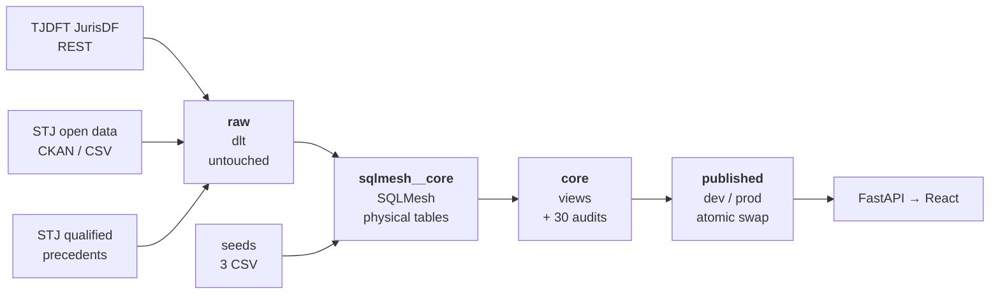

# ETL — Case Law

How judicial decisions get from a court API into the search screen.

This document describes the design: the layers, what each stage decides, and
which rules are derived rather than collected. For how to *run* it — commands,
environment variables, pacing, adding a court — see
[`pipeline/README.md`](../../pipeline/README.md).

Figures in this document were measured on 2026-10-23 against the development
database.

---

## 1. Shape of the pipeline



It is an **ELT**, not an ETL in the classic order. Data lands first and is
transformed in the database, because the transformation rules change far more
often than the collection does and a rule change must never mean asking a court
portal for 1.7 million documents again.

Two tools, two jobs:

| Tool | Job | Why not the other one |
|---|---|---|
| **dlt** | pull bytes in, change nothing | it has no opinion about the data, which is exactly what a landing zone needs |
| **SQLMesh** | turn raw into what the API reads | it versions models, plans changes before applying them, and runs audits |

### The four layers

| Layer | What lives there | Rows today |
|---|---|---|
| `raw` | the source's own response, field names and all | 2.4 M across 6 tables |
| `sqlmesh__core` | the physical, fingerprinted tables SQLMesh builds | 83 indexes |
| `core` | **views** over the above — the public contract | 1.37 M across 7 tables |
| published | a materialised copy on each server | `core_publicacao` |

`core` being views matters operationally: `pg_dump --schema core` produces
definitions and no rows. Publication materialises them first — see §6.

---

## 2. Extraction

Three connectors in [`pipeline/sources/`](../../pipeline/sources/), each landing
its own table. None of them transforms anything.

### 2.1 TJDFT — JurisDF

| | |
|---|---|
| Protocol | REST, paginated, 40 records per request |
| Lands in | `raw.acordao_tjdft` — **127,563** rows |
| Child table | `raw.acordao_tjdft__jurisprudenciaEmFoco` — 76,261 |
| Write mode | `merge` on `identificador` |
| Pacing | one request per 0.5 s, measured from the end of the previous |

The endpoint serves five collections and mixes them by default. The connector
asks for `base: acordaos` only.

Two parts of the response are deliberately dropped. `marcadores` holds search
highlight offsets, which say nothing about the decision. And inside
`jurisprudenciaEmFoco`, the `conteudo` buffer is dropped while its description
and link are kept: dlt writes a binary buffer as **one row per byte**, which
turned 120 decisions into 1.9 million rows and 328 MB. Keeping it would make the
collection terabyte-scale.

### 2.2 STJ — espelhos de acórdão

| | |
|---|---|
| Protocol | CKAN catalogue, bulk CSV |
| Lands in | `raw.espelho_stj` — **877,099** rows |
| Child tables | `acordaosSimilares` 1,309,628 · `referenciasLegislativas` 1,243,281 |
| Licence | Creative Commons Attribution |

### 2.3 STJ — qualified precedents

| | |
|---|---|
| Lands in | `raw.precedente_stj` — **2,403** rows |
| Write mode | `replace` — small enough to reload whole every run |

One trap worth recording, because it failed silently once: the dataset contains
both `temas.csv` and `dicionario-temas.csv`, and matching on the suffix
`temas.csv` picks the dictionary that *describes* the file instead of the file.
The run loaded 21 rows in place of 2,403 and reported success. The resource
match is now anchored on `/temas.csv`.

### 2.4 Seeds

Three CSVs in [`pipeline/transformations/seeds/`](../../pipeline/transformations/seeds/)
carry what no API returns:

| Seed | Rows | Carries |
|---|---|---|
| `fonte.csv` | 3 | per-source URL template, coverage window, status |
| `classe_processual.csv` | 847 | the CNJ procedural class table, with parentage |
| `tribunal.csv` | 2 | court name, sphere, state |

`fonte.csv` is what makes a link to the official document possible: the court
APIs do not return one, so `core.decisao` builds it by substituting the record's
identifier into `url_documento_template`.

### 2.5 Link verification

A separate step, [`verify_links.py`](../../pipeline/verify_links.py), asks each
source whether a document is still reachable and writes the answer to
`verificacao.link`. It runs at load time, never while answering a search — that
would make the search as slow and as available as the court's own site.

The result is **three states, not two**: `TRUE` reachable, `FALSE` gone, `NULL`
nobody has looked. A portal that is down produces unchecked records, never
broken ones; the run stops after ten consecutive failures rather than marking
the rest invalid.

---

## 3. Transformation

Seven models in [`pipeline/transformations/models/`](../../pipeline/transformations/models/).
Three are thin reads of the seeds; four carry rules.

| Model | Kind | Rows | What it is |
|---|---|---|---|
| `core.decisao` | FULL | **991,163** | one row per decision, both courts unioned |
| `core.decisao_precedente` | FULL | **375,189** | which precedent each decision cited |
| `core.precedente` | FULL | **1,482** | what the higher courts settled |
| `core.carga` | FULL | 145 | one row per extraction run |
| `core.classe_processual` | seed | 847 | CNJ class table |
| `core.fonte` | seed | 3 | sources |
| `core.tribunal` | seed | 2 | courts |

### 3.1 What is collected vs. derived

This is the distinction that matters for reading the data honestly.

**Collected** — arrives in the source response: process number, judging body,
rapporteur, dates, the ementa text, the seal flag.

**Derived** — read out of free text by rule, and therefore carrying a coverage
figure and an error mode:

| Column | Rule | Coverage |
|---|---|---|
| `decisao.resultado` | regex cascade over the dispositive | 95.9 % |
| `decisao.deliberacao` | unânime / maioria from the dispositive | 99.8 % |
| `decisao.classe_cnj` | name join against the CNJ table | 99.6 % |
| `decisao_precedente.*` | súmula and tema citations found in the ementa | 375,189 links |
| `decisao_precedente.aderencia` | followed / set aside / distinguished | 75.8 % |
| `precedente.enunciado` | reconstructed from how decisions quote it | 340 súmulas |

### 3.2 The cascade pattern

Three of those rules share a shape worth naming, because it is also their
failure mode. The Portuguese terms **contain one another**:

- `NEGAR PROVIMENTO` contains `PROVIMENTO`
- `não se aplica a súmula` contains `aplica`
- `parcialmente provido` contains `provido`

So **the order the patterns are tried in is the rule**, not an implementation
detail. Reversing it mislabels rows and nothing in a code review looks wrong:
the SQL is still valid, the column is still full, the figures are still
plausible. This is why each cascade has a `*_sem_contradicao` audit that
confronts every label with the pattern that outranks it, and a Python mirror
under `backend/tests/` that exercises the order against shapes taken from the
collection.

One stem bug found this way: `inaplicav` matches *inaplicável* but not
*inaplicabilidade*, whose stem is `inaplicab`. 7,472 links were being read as
the opposite of their meaning.

### 3.3 Reconstructing the súmulas

There is no public catalogue of súmulas anywhere — checked: the STJ open data
portal publishes none, the BDJur holds only internal manuals, `scon.stj.jus.br`
answers 403 to an identified client, and the STF and CNJ portals do not resolve.

So the text is reconstructed from the collection itself, where decisions quote
it between quotation marks. **Repetition is the verification**: 1,843 decisions
wrote the same sentence for Súmula 7/STJ, and a floor of three identical
transcriptions discards a capture that caught neighbouring text by accident.

The result is 340 súmulas covering 96.7 % of all súmula citations,
plus 1,142 temas from the official catalogue — 1,482 rows.

`situacao` is left NULL on purpose. A cancelled súmula is still cited in older
decisions, and showing a cancelled one as being in force is a serious error in a
legal tool. **The screen says it does not know; it never assumes.**

---

## 4. Data quality

**30 audit declarations** across the models — 22 written for this project plus
the built-in `not_null` and `unique_combination_of_columns`.

| Model | Audits |
|---|---|
| `core.decisao` | 16 |
| `core.decisao_precedente` | 7 |
| `core.precedente` | 5 |
| `core.carga` | 2 |

They fall into four families:

| Family | Guards against | Example |
|---|---|---|
| **Domain** | a value the screen cannot translate | `resultado_de_valor_conhecido` |
| **Coverage** | a rule going silent when wording changes | `classe_com_cobertura` ≥ 95 % |
| **Contradiction** | a cascade tried in the wrong order | `aderencia_sem_contradicao` |
| **Referential** | an orphan that joins to nothing | `citacao_de_tipo_conhecido` |

The coverage family exists for one specific failure: a court rewords its
dispositive, the pattern stops matching, the column fills with NULL, and
**nothing errors**. The screen simply shows less. A floor turns that into a
failed build. Floors sit below today's measured value with room to breathe, and
only apply above 100,000 rows so a sample environment does not fail by being
small.

> **Open gap.** CI does not run `sqlmesh audit`. All 30 declarations are
> verified only when someone runs it locally. Closing this is a candidate card
> under SCRUM-102.

Separately, the seal filter is pinned by `backend/tests/test_seal_filter.py`
rather than by an audit alone, because it has to stay true across *two*
mechanisms — see §6.

---

## 5. Lineage

Every published decision can be traced back:

```
core.decisao.carga_id ──> core.carga.carga_id ──> raw._dlt_loads
          │                                        (run id, status, timestamp)
          └─ fonte_codigo ──> core.fonte ──> url_documento_template
                                   │
                                   └─ tribunal_sigla ──> core.tribunal
```

`core.carga` reports per run: records read, records written, how many were
dropped for being under seal, how many links were invalid, and how many were
never checked. The last two are reported side by side on purpose — **zero
invalid means little when nobody looked**.

---

## 6. Publication

The pipeline runs on a developer machine; the servers only host.

```bash
uv run python -m publish dev producao
```

### The swap

The restore lands in a schema nobody reads. Then, in a single transaction, the
old schema is dropped and the new one renamed into its place. Two instant
statements, so a search sees either the previous dataset or the new one —
**never a mixture, and never an error**.

Only `core` travels. The raw layer stays on the machine that collected it: it
holds the original documents, including the ones under seal.

### Sealed cases

Courts seal cases after the fact, and a decision already on a server can stop
being public. Nothing deletes it there directly — and it does not need to. The
core layer is rebuilt from raw on every run with the seal filter applied, and
publication **replaces** the schema wholesale rather than adding to it. The
record is simply absent from the next one.

Two things must stay true, and both are pinned by tests:

1. the transformation drops anything flagged as sealed, every run
2. publication replaces the schema instead of merging into it

Moving publication to an incremental strategy would break this quietly: sealed
records would keep answering searches on the servers while disappearing locally.
If that day comes, removal has to become explicit.

The exposure window is the gap between the court sealing a case and the next
publication. Closing it further means publishing more often, not a different
mechanism.

---

## 7. Known limits

Things a reader of this data should know before drawing a conclusion from it.

| Limit | Detail |
|---|---|
| **STJ process numbers are not CNJ numbers** | 0 % match the CNJ format, so STJ decisions cannot be tied to a case. 13,915 TJDFT processes do have multiple decisions. |
| **Admissibility dominates the citations** | 75.3 % of súmula citations are procedural barriers — Súmula 7/STJ alone is 119,035. An adherence indicator built over all citations mostly describes admissibility, which the sprint scoped out. |
| **`aderencia` on "set aside" is the noisy class** | In *"inaplicabilidade do art. 741 … consoante enunciado da Súmula 487"* the negation belongs to the article, not the súmula. "Followed" is far more reliable. |
| **`conhecimento` is not implemented** | The column exists and is NULL everywhere. |
| **`precedente.url_fonte` is NULL** | No catalogue to link to; a documented deviation from the acceptance criterion. |
| **24.2 % of citation links have no adherence** | Decisions citing several precedents where the snippet carries no verb. Attributing one would be a guess. |
| **`link_valido` is 0 % filled locally** | Verification is a separate run and has not been executed against the current collection. |

---

## 8. Operating summary

| Step | Command | Where |
|---|---|---|
| Extract TJDFT | `uv run python -m sources.tjdft` | `pipeline/` |
| Extract STJ | `uv run python -m sources.stj` | `pipeline/` |
| Extract precedents | `uv run python -m sources.precedente` | `pipeline/` |
| Verify links | `uv run python verify_links.py` | `pipeline/` |
| Preview changes | `uv run sqlmesh plan` | `pipeline/transformations/` |
| Run audits | `uv run sqlmesh audit` | `pipeline/transformations/` |
| Publish | `uv run python -m publish dev producao` | `pipeline/` |

`plan` is the one that matters: it reports what changed and what would be
rebuilt, and waits for confirmation. Comments and audit bodies are metadata, so
editing them produces a **virtual update** — no rebuild of 991,163 rows.

Measured publication time for 107,828 decisions over the private network: 56 s
to the development server, 73 s to production.
