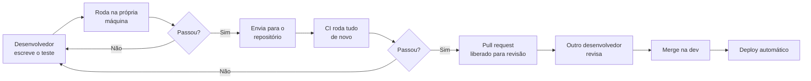

# Testes e integração contínua

Os mesmos testes rodam duas vezes: na máquina de quem escreve o código, e de
novo no servidor quando o código é enviado. Este documento explica o que o
desenvolvedor faz, o que o CI faz, e por que as duas coisas existem.

---

## O que o desenvolvedor faz

**1. Escolhe o que testar.** Na tarefa do Jira ficam registrados a unidade
escolhida — uma regra de negócio, um serviço, um utilitário ou um componente de
tela — e os critérios de aceitação que o teste precisa verificar.

**2. Escreve o teste isolando a unidade.** Cada cenário segue a forma **Dado,
Quando, Então**: o contexto inicial, a ação testada e o resultado esperado.
Cobre o caminho normal, os limites que importam e os casos de erro. Teste que
depende de banco real ou de vários módulos conectados é teste de integração,
não de unidade.

**3. Roda na própria máquina.** Executa o arquivo da parte que mexeu, vê o
resultado em segundos e corrige na hora.

**4. Abre o pull request com a evidência.** Registra a tarefa do Jira, os
cenários cobertos, os caminhos dos arquivos de teste, os comandos exatos que
executou e o resultado real — inclusive falhas e casos pulados.

**5. Outro desenvolvedor revisa.** O revisor confere se os testes correspondem
aos critérios combinados, se a unidade está isolada e se a evidência é
confiável. Falha de teste introduzida pelo pull request é responsabilidade de
quem o abriu.

---

## As duas passagens

### Primeira passagem: na máquina do desenvolvedor

Enquanto escreve, o desenvolvedor roda os testes da parte que está mexendo. É
uma passagem rápida e parcial: ele executa o arquivo de teste que interessa, vê
o resultado em segundos e corrige na hora.

Essa passagem é **limitada de propósito**. Ela usa o banco da máquina dele, as
dependências que ele já tem instaladas e só a parte do sistema que ele tocou.
Serve para trabalhar rápido, não para garantir nada.

### Segunda passagem: no CI

Quando o código é enviado, o GitHub executa tudo de novo — **do zero, numa
máquina limpa**, sem nada do que estava instalado no computador do
desenvolvedor.

É essa passagem que vale como garantia. Ela pega três coisas que a primeira não
pega:

- **Dependência que só existe na máquina de quem escreveu.** O CI instala tudo
  a partir da lista do projeto. Se faltou declarar alguma, ele falha.
- **Teste que o desenvolvedor não rodou.** Ele rodou a parte dele; o CI roda o
  sistema inteiro, e descobre se a mudança quebrou algo distante.
- **Banco de dados em estado diferente.** O CI sobe um banco vazio e novo a cada
  execução. Teste que só passava porque havia dado antigo na máquina do
  desenvolvedor falha aqui.

---

## Quando o CI roda

| Situação | O CI roda? |
|---|---|
| Abrir um pull request | Sim |
| Enviar mais código para um pull request aberto | Sim, de novo |
| Merge em `dev`, `producao` ou `main` | Sim |

Enquanto o CI não termina, o pull request fica marcado como pendente. Se ele
falhar, o pull request fica marcado em vermelho e não deve ser aprovado.

---

## O que o CI executa

São três frentes que rodam **em paralelo**, e as nove etapas precisam passar.

### Backend

| Etapa | O que verifica |
|---|---|
| Lint | Problemas de código que o analisador reconhece |
| Formatação | Se o código está no formato padrão do projeto |
| Verificação de tipos | Se os tipos declarados batem com o uso real |
| Testes | 1.106 testes |

Sobe um banco PostgreSQL novo para os testes, além de instalar o renderizador
de PDF usado na exportação.

### Pipeline

| Etapa | O que verifica |
|---|---|
| Testes | 149 testes |

Também sobe um banco próprio, separado do banco do backend.

### Frontend

| Etapa | O que verifica |
|---|---|
| Lint | Problemas de código |
| Formatação | Formato padrão |
| Verificação de tipos | Tipos do TypeScript |
| Testes | 621 testes |

**Total: 1.876 testes.**

---

## Depois que o CI passa

O CI verde **não libera o merge sozinho**. Antes é preciso que outro
desenvolvedor revise e aprove o pull request. Teste passando prova que o código
funciona; não prova que ele faz a coisa certa.

Quando o código entra em `dev` ou `producao`, o deploy **espera o CI terminar**
antes de rodar. Código que não passou nos testes não chega ao ar.

---

## Por que rodar duas vezes

A primeira passagem é para quem escreve: rápida, parcial, no meio do trabalho.

A segunda é para o time: completa, limpa e igual para todo mundo. É ela que
sustenta a frase "está testado" quando o código vai para produção.

Nenhuma substitui a outra. Quem só roda na própria máquina descobre o problema
no CI, depois de já ter aberto o pull request. Quem só confia no CI perde tempo
esperando o servidor para achar um erro que apareceria em dez segundos
localmente.
